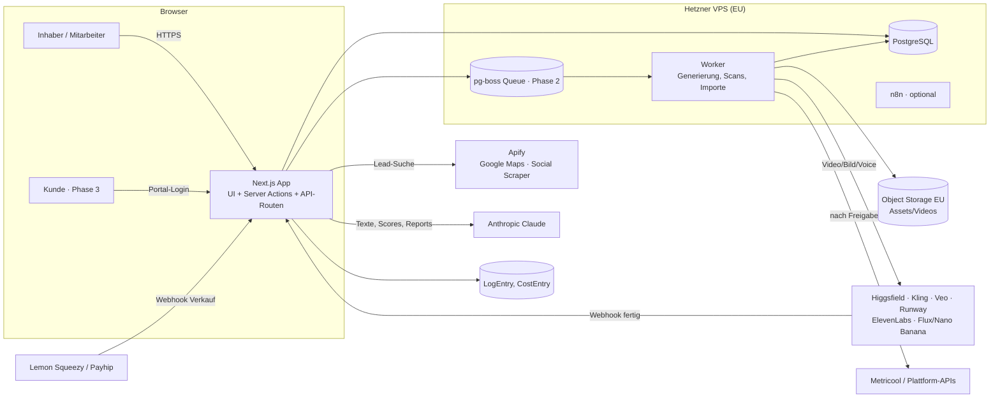
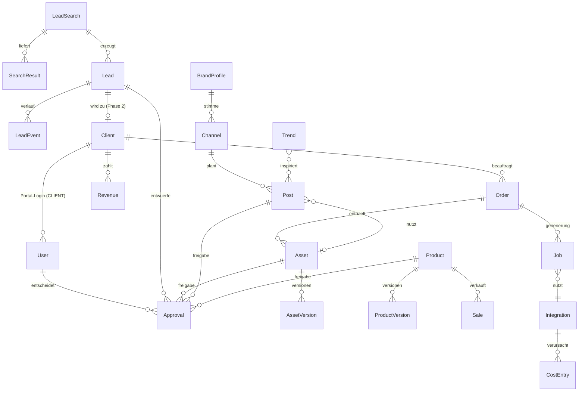

# Business Cockpit – Konzept & Umsetzungsplan

> Stand: 17. 11. 2026. Preise und API-Angaben sind nach bestem Wissen recherchiert. **⚠ = unsicher, vor Kauf prüfen.**

## 0. Annahmen (Platzhalter aus dem Briefing)

Das Briefing enthielt offene Platzhalter. Ich habe folgende Annahmen getroffen. Jede lässt sich ändern, die Zahlen skalieren dann mit.

| Platzhalter | Annahme | Begründung |
|---|---|---|
| Zeit | **10 h/Woche** (≈ 43 h/Monat) | typischer Nebenerwerb |
| Markt | **Wien, Österreich**; Recht AT + EU | § 107 TKG im Briefing deutet auf AT |
| Nische eigene Marke | **„KI-Content für lokale Kleinbetriebe & Selbstständige“** | Synergie: Was du im Kundengeschäft lernst, wird zum Produkt (Vorlagen, Prompt-Packs, Mini-Kurs) |
| Tool-Budget | **150 €/Monat** (Budget-Variante 60–90 €) | |
| Umsatzziel Monat 6 | **3.000 €/Monat** | realistisch bei 10 h/Woche |
| Vorhanden | Apify-Account, Claude-Zugang | laut Briefing |

---

## 1. Executive Summary

1. **Empfehlung:** Starte mit **lokalem Kurzvideo-Service für Wiener Friseure, Beauty, Cafés und Fitness** (Paket ab 390 €/Monat). Die eigene Marke läuft nebenher und mit wenig Aufwand, weil sie erst ab Monat 4–6 nennenswert Umsatz bringt.
2. Das Cockpit wächst mit dem Geschäft. **Phase 1 ist gebaut und lauffähig:** Login, Lead-Finder (Google Maps über Apify), regelbasierter Lead-Score, CRM-Kanban, KI-Entwürfe für die Erstansprache mit Pflicht-Freigabe, Finanz- und Kosten-Tracking mit Budget-Stopp, verschlüsselte API-Schlüssel und Löschkonzept.
3. **Nutzen:** Ein Abend reicht für die Lead-Recherche eines Bezirks (Kosten unter 0,50 €). KI-Entwürfe sparen etwa 70 % Schreibzeit. Alle Zahlen liegen an einem Ort.
4. **Schnellster Weg zum ersten Kunden:** Bezirk wählen, 40 Betriebe scannen, die Top-10 persönlich besuchen und ein **kostenloses Probevideo** anbieten. Daraus werden 1–2 Kunden in 3–4 Wochen.
5. Ein **Kunde mit dem Starter-Paket deckt sämtliche Tool-Kosten** (Break-even der Fixkosten).
6. **Ziel 3.000 €/Monat nach 6 Monaten:** zum Beispiel 2× Standard + 2× Starter (2.360 €) plus etwa 640 € aus digitalen Produkten. Das passt in rund 40 h/Monat.
7. **Größtes rechtliches Risiko:** Kaltakquise. In Österreich sind Werbe-E-Mails, -SMS und -Anrufe ohne Einwilligung **auch an Unternehmen** verboten (§ 174 TKG 2021, früher § 107). Deshalb setzt die App auf persönlichen Besuch und Brief.
8. **Größtes wirtschaftliches Risiko:** Preisdruck durch billige KI-Content-Anbieter. Gegenmittel: lokale Präsenz, echte Drehs mit dem Handy kombiniert mit KI, und messbare Reports.
9. **Größtes technisches Risiko:** sich schnell ändernde KI-Video-APIs. Gegenmittel: eine Abstraktionsschicht pro Tool und ein manueller Upload-Pfad für alles.
10. Nicht gleich alles bauen: Trend-Radar, Produkt-Fabrik und Kundenportal kommen erst, wenn **mindestens 2 zahlende Kunden** da sind.

---

## 2. Geschäftsmodell

### Positionierung
**„Kurzvideos, die nach eurem Grätzl aussehen – jede Woche, ohne dass ihr filmen müsst.“**
Dein Vorteil gegenüber Agenturen: Preis und Geschwindigkeit. Dein Vorteil gegenüber Fiverr und KI-Tools: du bist vor Ort, kennst den Bezirk und lieferst Strategie mit.

### Zielkunden (Priorität)
| Rang | Branche | Warum | Typische Lücke |
|---|---|---|---|
| 1 | Friseur, Barber, Kosmetik, Nails | sehr visuell, Instagram-getrieben, hohe Dichte in Wien | wenige Reels, keine Vorher/Nachher-Serien |
| 2 | Cafés, Bäckereien, Brunch, Restaurants | Laufkundschaft, saisonale Aktionen | Speisekarte nur als PDF, keine Videos |
| 3 | Fitness, Yoga, Physio | Neukunden-getrieben, Abo-Modelle | Probetraining nicht beworben |
| 4 | Handwerk (Tischler, Fliesen, Maler) | Projekte zeigen, Mitarbeitersuche | kaum Social Media, Recruiting-Druck |

### Angebotspakete (netto, Wien)

| | **Probe** | **Starter** | **Standard** ⭐ | **Premium** |
|---|---|---|---|---|
| Preis | 0 € (1 Video) | **390 €/Monat** | **790 €/Monat** | **1.490 €/Monat** |
| Inhalt | 1 Kurzvideo zum Kennenlernen | 4 Kurzvideos, 4 Bild-Posts, Captions | 8 Kurzvideos, 8 Posts, Redaktionsplan, Monatsreport | 12 Videos inkl. Avatar/UGC-Stil, Werbe-Varianten (3 Hooks je Video), halber Drehtag pro Quartal, Report-Call |
| Laufzeit | – | 3 Monate | 3 Monate | 6 Monate |
| Einmal-Option | – | Setup 149 € (Branding, Vorlagen) | Setup inklusive | Setup inklusive |

### Zeit- und Margenkalkulation (pro Kunde und Monat)

| Paket | Zeit Produktion | Abstimmung/Report | Summe | Tool-Kosten (Anteil) | Deckungsbeitrag | €/h |
|---|---|---|---|---|---|---|
| Starter | 4 × 40 min = 2,7 h | 1,5 h | **4,2 h** | ~20 € | 370 € | **≈ 88 €/h** |
| Standard | 8 × 35 min = 4,7 h | 2,5 h | **7,2 h** | ~40 € | 750 € | **≈ 104 €/h** |
| Premium | 12 × 40 min + Drehtag/3 ≈ 9,3 h | 3 h | **12,3 h** | ~90 € | 1.400 € | **≈ 114 €/h** |

Annahme: Die Minuten pro Video gelten **mit Branchen-Vorlagen** (Phase 2). Ohne Vorlagen rechne mit dem Doppelten in den ersten 4–6 Wochen.

### Kapazität und Zielerreichung (43 h/Monat)
- Akquise und Admin: 10 h · eigene Marke und Produkte: 8 h · **Kundenarbeit: 25 h**
- 25 h reichen für 2× Standard (14,4 h) + 2× Starter (8,4 h) = 22,8 h, das ergibt **2.360 €**
- Produkte: 640 € ≈ 24 Verkäufe à 27 € (z. B. „Reel-Vorlagen-Pack für Friseure“). Das ist ambitioniert. Der Plan geht auch ohne Produkte auf, wenn du stattdessen einen Standard-Kunden mehr gewinnst.

### Break-even
- Fixkosten (Wachstumsvariante) ≈ 150 €/Monat → **0,4 Starter-Kunden**
- Fixkosten plus Opportunitätskosten deiner Zeit (z. B. 30 €/h × 43 h = 1.290 €) → **≈ 1.440 €/Monat** = 2 Standard-Kunden

### Akquise-Rechnung (Schätzwerte)
200 gescannte Betriebe → 40 mit Score ≥ 70 → 25 Besuche → 8 Probevideos → **3 Kunden**. Kosten: Apify unter 1,50 €, Claude etwa 2 €, Zeit etwa 12 h. **CAC ≈ 4 € Tools + 4 h Zeit pro Kunde.**

---

## 3. Systemarchitektur

### Tech-Stack (Begründung)
| Schicht | Wahl | Warum |
|---|---|---|
| Frontend + Backend | **Next.js 16 (App Router, Server Actions), React 19, Tailwind 4** | eine Codebasis, kein separates API-Projekt, gut für Solo-Betrieb |
| Datenbank | **PostgreSQL** (lokal SQLite) über **Prisma** | relational passt zu CRM und Finanzen, Migrationen, typsicher |
| Auth | eigene Session (JWT im httpOnly-Cookie, bcrypt), Rollen OWNER/STAFF/CLIENT | keine zusätzliche Abhängigkeit; in Phase 3 optional Magic-Link für Kunden |
| Jobs | **Phase 1:** synchron (Apify run-sync, max. 5 min). **Phase 2:** **pg-boss** (Queue in Postgres) + Webhooks der Tools + Status-Polling | keine Redis-Instanz nötig |
| KI-Kern | **Claude** (Anthropic SDK), Kosten pro Aufruf in `CostEntry` | Texte, Bewertungen, Skripte, Reports |
| Datenerhebung | **Apify** (Google Maps, später TikTok, Instagram, YouTube) | vorhanden, Pay-per-Result |
| Dateien | **Hetzner Object Storage** (S3-kompatibel, EU) | Assets und Videos, günstig |
| Orchestrierung | **Kern-Workflows im Backend**, n8n optional für Glue-Code | siehe unten |

### Orchestrierung: Backend vs. n8n vs. Make
| Kriterium | Backend (Code) | n8n self-hosted | Make |
|---|---|---|---|
| Kosten | 0 € | 0 € (auf demselben Server) | ab ~10 €/Monat, Ops-basiert ⚠ |
| Flexibilität | maximal, typsicher, testbar | hoch, visuell | mittel |
| Wartung | Code-Pflege | Updates, zweite UI, Credentials doppelt | gering |
| Datenschutz | alles in deiner DB | EU, selbst gehostet | EU-Rechenzentrum wählbar |
| **Urteil** | **Kern: Leads, Freigaben, Kosten, Generierung** | **später für Ad-hoc-Integrationen** (z. B. Google Sheets, Gmail-Benachrichtigung) | verwerfen |

**Warum nicht alles in n8n?** Freigabe-Status, Budget-Stopp und Kostenbuchung müssen in **einer** Datenbank konsistent sein. Workflows in zwei Systemen verdoppeln Fehlerquellen.

### Hosting
| Option | Kosten/Monat | EU-Standort | Eignung |
|---|---|---|---|
| **Hetzner Cloud CX22 + Coolify** ⭐ | ~5–8 € + Storage Box ~4 € für Backups ⚠ | Falkenstein, Nürnberg, Helsinki | **Empfehlung:** lange Requests und Jobs ohne Timeouts, n8n und Postgres auf demselben Server, volle Kontrolle |
| Vercel Pro + Supabase Pro | 20 $ + 25 $ | Supabase Frankfurt; Vercel-Funktionen in fra1 wählbar | wenig Ops, aber Funktions-Timeouts (Apify-Sync bricht ab), US-Anbieter (DPA/SCC nötig). Vercel Hobby ist **nicht für kommerzielle Nutzung** erlaubt |
| Railway | ~5–20 $ nutzungsbasiert | EU-Region (Amsterdam) ⚠ | bequem, Kosten schwer vorhersehbar |

### Architektur (Mermaid)



### Datenfluss (Kurzform)
Recherche (Apify) → **Rohdaten** (SearchResult, 30 Tage) → **Lead** (Score) → KI-Entwurf → **Approval** (Freigabe) → Kontakt → Kunde → Auftrag → Assets → Approval → Auslieferung/Post → Performance → zurück in Insights. **Jeder kostenpflichtige Aufruf** prüft vorher das Budget und bucht danach eine `CostEntry`.

---

## 4. Tool-Stack

Legende API: ✅ offiziell · 🟡 eingeschränkt oder über Drittanbieter · ❌ keine

### Variante A – Budget (~60–90 €/Monat)
| Tool | Zweck | Bereich | Kosten/Monat | API | Alternative |
|---|---|---|---|---|---|
| Hetzner CX22 + Storage Box | Hosting, DB, Backups | alle | ~10 € ⚠ | ✅ | Railway |
| Claude API | Texte, Scores, Skripte, Reports | alle | ~5–15 € (nutzungsbasiert) | ✅ | – |
| Apify (Free + Pay-per-Event) | Google Maps, Social-Trends | 1 | 0–10 € (Google Maps ~0,004 $/Ort + 0,002 $ Kontakte) | ✅ | Outscraper |
| **Higgsfield** Basic/Pro | Video (Kamera-Presets, UGC, Marketing Studio) | 2, 3 | ~9–29 $ ⚠ | 🟡 (siehe unten) | Kling direkt |
| Nano Banana (Gemini Image) | Bilder, Edits mit Produktfotos | 2, 3 | ~0,04 $/Bild ⚠ | ✅ | Flux (BFL/fal.ai) |
| ElevenLabs Starter | Voice-over, kommerzielle Lizenz | 2, 3 | ~5 $ | ✅ | – |
| CapCut (Free/Pro) | Schnitt, Untertitel | 2, 3 | 0–10 € | ❌ (manuell) | DaVinci Resolve |
| Canva Pro | Designs, Vorlagen | 2–4 | ~12 € | 🟡 (Connect API, Autofill nur Enterprise ⚠) | Figma |
| Metricool Free | Planung, Analyse | 3 | 0 € | ❌ im Free-Plan | Buffer |
| Payhip Free | Shop, EU-USt als MoR ⚠ | 4 | 0 € + 5 % | ✅ Webhooks | Lemon Squeezy |

### Variante B – Wachstum (~150–250 €/Monat)
| Tool | Zweck | Bereich | Kosten/Monat | API | Alternative |
|---|---|---|---|---|---|
| Hetzner CX32 + Object Storage | Hosting, Assets | alle | ~15–20 € ⚠ | ✅ | – |
| Claude API | wie oben, mehr Volumen | alle | ~20–40 € | ✅ | – |
| Apify Starter | Trend-Radar täglich, Wettbewerbs-Monitor | 1 | ~39 $ ⚠ | ✅ | – |
| Higgsfield Pro/Ultimate | Hauptwerkzeug Video | 2, 3 | ~29–49 $ ⚠ | 🟡 | – |
| Kling API **oder** Veo 3 (Gemini API) | automatisierbare Video-Generierung | 2, 3 | nutzungsbasiert, Veo ~0,15–0,40 $/s ⚠ | ✅ | Runway API (Credits) |
| HeyGen Creator | Avatare, Übersetzungen | 2 | ~29 $; API separat ⚠ | 🟡 | Synthesia (API eher Enterprise ⚠) |
| ElevenLabs Creator | Stimmen, Voice-Cloning mit Einwilligung | 2, 3 | ~22 $ | ✅ | – |
| Metricool Advanced | Planung über API, Multi-Brand für Kunden | 3 | ~45–55 € ⚠ | ✅ (Advanced) | Ayrshare (API-first) |
| Lemon Squeezy | Shop, Merchant of Record | 4 | 5 % + 0,50 $ | ✅ | Payhip, Digistore24 |
| Canva Pro | Design | 2–4 | ~12 € | 🟡 | – |

### Tool-Bewertung (Entscheidung)
| Tool | Urteil | Begründung |
|---|---|---|
| **Higgsfield** | **behalten, zentral** | Die Kamera-Presets, Marketing Studio und der UGC-Builder sind stark für Werbeclips. ⚠ **API-Status unsicher:** Higgsfield bietet eine Entwickler- bzw. Cloud-API für einzelne Modelle. Ob Marketing Studio und UGC-Builder per API oder MCP steuerbar sind, konnte ich nicht verifizieren. **Plan:** API-Anbindung, wo sie existiert. Sonst erzeugt die App Prompt und Briefing, du generierst in der Higgsfield-Oberfläche und lädst das Ergebnis per **manuellem Upload-Schritt** hoch (in der Pipeline vorgesehen). |
| Kling | behalten als API-Backup | gute Qualität und Preis, offizielle API und über fal.ai erreichbar |
| Google Veo 3 | behalten (Wachstum) | beste Audio-Video-Kombination, API über Gemini/Vertex, aber teuer pro Sekunde ⚠ |
| Runway | optional | solide API und Credits; Überschneidung mit Kling und Veo |
| Sora | verwerfen (vorerst) | API-Verfügbarkeit und Preise für EU-Kunden unsicher ⚠, Wasserzeichen- und Rechtefragen |
| HeyGen | behalten (Premium-Paket) | Avatar-Videos, Übersetzung; Avatare nur mit schriftlicher Einwilligung der dargestellten Person |
| Synthesia | verwerfen | API in der Praxis Enterprise-Preis ⚠ |
| ElevenLabs | behalten | Standard für Voice-over, API, kommerzielle Lizenz ab Starter |
| Midjourney | **verwerfen für Automation** | keine offizielle API; manuell möglich |
| Flux / Nano Banana | behalten | API, günstig; Nano Banana gut für Edits echter Produktfotos |
| CapCut | behalten, manuell | keine API; Vorlagen beschleunigen. ⚠ Nutzungsbedingungen zu Rechten an Inhalten prüfen |
| Canva | behalten | Vorlagen und Brand Kit; Automation erst mit Enterprise sinnvoll |

---

## 5. Seitenstruktur & Navigation

| Seite | Phase | Wichtigste UI-Elemente |
|---|---|---|
| **/login** | 1 ✅ | E-Mail und Passwort, Sperre nach 5 Fehlversuchen |
| **/ Übersicht** | 1 ✅ | 6 KPI-Kacheln, „Wartet auf deine Freigabe“ mit Buttons, Aktivitäts-Feed, Umsatz-Chart (6 Monate), Funnel-Chart, Demo-Hinweis |
| **/leads Lead-Finder** | 1 ✅ | Suchmaske (Branche mit Vorschlägen, Bezirk, Anzahl, Kostenschätzung), Ergebnistabelle mit Score-Badge und Gründen, Filter Score ≥ 45/70, Mehrfachauswahl → CRM, Suchhistorie. *Karte: Phase 2 (Leaflet + OSM)* |
| **/crm** | 1 ✅ | Kanban (Lead → Kontaktiert → Termin → Angebot → Kunde → Upsell → Verloren), Suche, Pipeline-Wert. Statuswechsel per Auswahl (mobilfreundlich); Drag & Drop in Phase 2 |
| **/crm/[id]** | 1 ✅ | Stammdaten, Score-Gründe, KI-Einschätzung, Entwurf „Besuchsleitfaden“ oder „Brief“ → Freigabe, Deal-Wert, nächster Schritt, Notiz-Timeline, DSGVO-Löschen |
| **/freigaben** | 1 ✅ | editierbarer Entwurf, Pflicht-Checkbox „überarbeitet + KI-Kennzeichnung geprüft“, Freigeben/Ablehnen, Protokoll (wer, wann) |
| **/finanzen** | 1 ✅ | KPI (Umsatz, Kosten, Deckungsbeitrag, Tool-Kosten je Neukunde), Erfassung Umsatz und Fixkosten, 6-Monats-Tabelle, Kosten je Tool, Break-even-Hinweis |
| **/einstellungen** | 1 ✅ | Integrationskarten (Schlüssel verschlüsselt, Status, Test, Monatslimit, Verbrauch), Automations-Übersicht, Löschkonzept starten, Benutzer, Protokoll |
| /trends Trend-Radar | 2 | sortierbare Liste (Trend-Score, Sparkline), Quellen-Filter, „Idee in Kalender“ |
| /wettbewerb | 2 | beobachtete Accounts, Posting-Frequenz, Engagement |
| /insights | 2 | wöchentliche KI-Zusammenfassung mit Handlungsempfehlungen |
| /studio Aufträge | 2 | Kanban Briefing → Skript → Generierung → Schnitt → intern → Kunde → ausgeliefert |
| /studio/[auftrag] | 2 | Briefing-Formular → Hooks/Skript/Prompts, Generierungs-Jobs mit Status, Upload-Slot, Versionen |
| /assets | 2 | Bibliothek mit Vorschau, Tags, Versionen, Branchen-Vorlagen |
| /kalender | 2 | Monats- und Wochenansicht, Drag & Drop, Kanal-Filter |
| /produkte | 2 | Ideen-Backlog → Assistent (8 Schritte) → Editor → Verkaufsseite |
| /portal (Kunde) | 3 | Freigabe, Kommentare, Download, Report |

### Wireframe Startseite (Text) – umgesetzt, siehe `docs/screenshots/dashboard.png`

```
┌──────────────┬────────────────────────────────────────────────────────────┐
│ Business     │ Übersicht                          [+ Leads suchen]         │
│ Cockpit      │ Dienstag, 17. November 2026                                 │
│              │ ⚠ Demo-Modus für: Apify, Claude → Einstellungen            │
│ ◧ Übersicht  │ ┌────────┐┌────────┐┌────────┐┌────────┐┌────────┐┌───────┐│
│ ⌖ Lead-Finder│ │Umsatz  ││Offene  ││Aktive  ││Tool-   ││Geplante││Verkauf││
│ ☰ CRM        │ │€ 390   ││Leads 4 ││Kunden 0││Kosten  ││Posts – ││Prod. –││
│ ✓ Freigaben③ │ │VM/VJ   ││4 neu   ││        ││0,0 %   ││Phase 2 ││Phase 2││
│ € Finanzen   │ └────────┘└────────┘└────────┘└────────┘└────────┘└───────┘│
│ ⚙ Einstell.  │ Wartet auf Freigabe        │ Aktivität                      │
│              │ ┌────────────────────────┐ │ [crm] 4 Leads übernommen 13:55 │
│ PHASE 2/3    │ │Besuchsleitfaden: Glanz │ │ [lead-finder] Suche …   13:55 │
│ Trend-Radar  │ │„Grüß Gott, …“          │ │ [budget] ⚠ 80 % Apify  …      │
│ Studio …     │ │☐ KI geprüft [✓][✕]     │ │                                │
│              │ └────────────────────────┘ │                                │
│ [Abmelden]   │ Umsatz 6 Monate ▁▁▂▃▅█     │ Funnel █▅▃▂▁▁                  │
└──────────────┴────────────────────────────────────────────────────────────┘
```

---

## 6. Datenmodell

**Phase 1 (gebaut, `prisma/schema.prisma`):** User, Lead, LeadSearch, SearchResult, LeadEvent, Approval, Revenue, CostEntry, Integration, LogEntry.
**Phase 2/3 (geplant):** Client, Order, Asset, AssetVersion, Post, Channel, BrandProfile, Product, ProductVersion, Sale, Trend, Competitor, Job, PromptTemplate.



| Tabelle | Wichtige Felder | Hinweise |
|---|---|---|
| **User** | email, name, passwordHash, role (OWNER/STAFF/CLIENT), clientId? | bcrypt (Kosten 12) |
| **Lead** | placeId (unique), name, category, address, district, phone*, website, instagram, rating, reviewsCount, imagesCount, claimed, lat/lng, score, scoreReasons(JSON), aiSummary, status, dealValue, nextAction(+At), deleteAfter | *nur öffentliche Geschäftsnummer. `deleteAfter` setzt das Löschkonzept um |
| **LeadSearch / SearchResult** | query, location, maxResults, costEur, demo / data(JSON), score, imported | Rohdaten werden nach 30 Tagen gelöscht |
| **LeadEvent** | type (NOTE/STATUS/AI/CONTACT), text | Audit-Trail je Lead |
| **Approval** | type (OUTREACH/POST/CLIENT_DELIVERY/PRODUCT), title, content, channel, aiGenerated, **aiLabelOk**, status, decidedBy, decidedAt, comment | zentrale Human-in-the-Loop-Tabelle für alle Bereiche |
| **Revenue** | date, amount (netto), stream (SERVICE/PRODUCT), leadId/clientId | Phase 2: automatisch aus Sale |
| **CostEntry** | date, tool, amount €, units, unitLabel, fixed | Basis für Kosten pro Asset, Budget-Stopp |
| **Integration** | key, secretEnc (AES-256-GCM), budgetMonthly, status, lastCheckAt | Schlüssel nie im Klartext |
| **LogEntry** | level, source, message | Aktivitäts-Feed und Fehlerprotokoll |
| Client (P2) | leadId, package, mrr, startDate, contractEnd, brandProfileId, consentAvatar/Voice | Vertragsdaten, Einwilligungen |
| Order (P2) | clientId, month, stage (Kanban), briefing, scriptJson, dueAt, minutesSpent | Zeiterfassung → Produktionszeit pro Video |
| Asset / AssetVersion (P2) | orderId, type, tags[], industry, storageKey, tool, costEur, aiGenerated, aiDisclosure | Kosten pro Asset |
| Job (P2) | type, tool, externalId, status, payload, result, attempts | Queue, Webhooks, Polling |
| Post / Channel (P2) | channelId, assetId, caption, hook, scheduledAt, publishedAt, externalId, metrics(JSON) | Performance pro Hook und Format |
| Product / ProductVersion / Sale (P2) | title, stage (Idee…Launch), demandEvidence, price, platform, externalId / amount, fee, vat, country | Import über Webhook |
| Trend / Competitor (P2) | source, term, score, series(JSON) / handle, platform, postFreq, engagement | |

---

## 7. Workflows

Legende: **[A]** automatisch · **[KI+F]** KI mit Freigabe · **[M]** manuell. ✅ = in Phase 1 umgesetzt.

### (a) Lead-Recherche bis Erstansprache ✅
1. **[M]** Branche und Bezirk wählen (z. B. „Friseur“, „1070 Wien“), Anzahl 40.
2. **[A]** Budget-Check, bei Überschreitung Stopp und Log-Eintrag.
3. **[A]** Apify-Scraper läuft (nur Unternehmensdaten, keine Reviews, keine Personen-Leads), Kosten werden gebucht.
4. **[A]** Regel-Score 0–100 mit Begründung; Dubletten (placeId) werden markiert.
5. **[M]** Treffer ab Score 60 sind vorausgewählt; per Klick ins CRM übernehmen (Löschfrist 180 Tage).
6. **[KI+F]** Optional: Claude-Einschätzung (Potenzial, Lücke, Einstiegsangebot, Risiko).
7. **[KI+F]** Entwurf „Besuchsleitfaden“ oder „Brief“ landet in **Freigaben**.
8. **[M]** Überarbeiten, Checkbox setzen, freigeben. Das wird im Verlauf protokolliert.
9. **[M]** Persönlich vorbeigehen oder Brief mit QR-Code schicken, Status „Kontaktiert“, nächsten Schritt mit Datum setzen.
10. **[M]** Termin → Angebot → Kunde. Ab „Kontaktiert“ gilt keine automatische Löschung mehr; aus Leads, die nicht reagieren, wird „Verloren“ und sie verfallen.

### (b) Kundenvideo von Briefing bis Auslieferung (Phase 2)
1. **[M]** Briefing-Formular: Ziel, Angebot, Zielgruppe, Ton, Pflichtinhalte, echte Fotos/Clips hochladen.
2. **[KI+F]** Claude erzeugt 10 Hooks; du wählst 1–3 aus.
3. **[KI+F]** Videoskript mit Shotlist plus Video-/Bild-Prompts pro Szene, Freigabe intern.
4. **[A]** Generierungs-Jobs (Kling/Veo/Higgsfield-API, Nano Banana, ElevenLabs) in der Queue; Status per Webhook oder Polling; Kosten pro Asset werden gebucht.
5. **[M]** Higgsfield-Funktionen ohne API (Marketing Studio, UGC-Builder): Prompt kopieren, extern erzeugen, **im Upload-Slot hochladen**.
6. **[M]** Schnitt in CapCut (Branchen-Vorlage), finale Datei hochladen. Version 2 wird angelegt.
7. **[KI+F]** Interne Freigabe mit Pflichtfeld KI-Kennzeichnung (z. B. „KI-generiert“ im Plattform-Label, Hinweis bei realistischen Personen).
8. **[KI+F]** Kundenfreigabe (Phase 3 im Portal; bis dahin Link per Mail an Bestandskunden, was mit Vertrag zulässig ist).
9. **[A]** Ausgeliefert: Download-Link, Asset wird archiviert, Zeiterfassung abgeschlossen.

### (c) Eigener Post von Trend bis Veröffentlichung (Phase 2)
1. **[A]** Täglicher Trend-Scan (Apify: TikTok-/Instagram-Hashtags der Nische, YouTube Shorts) plus Google-Trends- und Reddit-Abgleich → Trend-Score.
2. **[KI+F]** Insight-Generator: 5 Themenvorschläge pro Woche mit Begründung → Klick „in Kalender“.
3. **[KI+F]** Skript mit Markenstimme (BrandProfile).
4. **[A]/[M]** Produktion wie (b) 4–6.
5. **[KI+F]** Freigabe inklusive KI-Label und Caption.
6. **[A]** Veröffentlichung über die Metricool-API bzw. offizielle Plattform-APIs zum geplanten Zeitpunkt. **Keine inoffiziellen Bots.**
7. **[A]** Nach 48 h und nach 7 Tagen Metriken importieren; Hook- und Format-Auswertung fließt in Trend-Score und Produkt-Backlog zurück.

### (d) E-Book von Idee bis Verkauf (Phase 2)
1. **[A]** Backlog-Eintrag aus Bedarfsnachweis (häufigste Fragen in Kommentaren, Top-Posts).
2. **[KI+F]** Gliederung, freigeben oder ändern.
3. **[KI+F]** Kapitelentwürfe.
4. **[M]** **Pflicht-Überarbeitung im Editor.** Die App blockiert den nächsten Schritt, bis mindestens 20 % des Textes geändert sind und jedes Kapitel als „bearbeitet“ markiert ist.
5. **[KI+F]** Faktencheck: Claude markiert prüfbedürftige Aussagen; du bestätigst Quellen.
6. **[A]** Layout und PDF-Export (Vorlage).
7. **[KI+F]** Verkaufsseite und Launch-Kampagne (5 Posts, 3 E-Mails an die Opt-in-Liste).
8. **[M]** Produktfreigabe → Upload auf Lemon Squeezy/Payhip (bzw. per API) → **[A]** Verkäufe kommen per Webhook ins Dashboard.

---

## 8. Prompt-Bibliothek

Allen Prompts wird der System-Prompt aus `lib/prompts.ts` vorangestellt (Markenkontext, Deutsch, keine erfundenen Fakten). Platzhalter stehen in `{…}`.

**8.1 Lead-Bewertung** ✅ (im Code: `LEAD_ASSESSMENT`)
```
Bewerte diesen lokalen Betrieb als potenziellen Kunden für monatliche Kurzvideo-Pakete.
{Betrieb, Branche, Bezirk, Bewertung, Fotos, Website, Instagram, Score-Gründe}
Antworte in genau diesem Format, max. 120 Wörter:
**Potenzial:** hoch / mittel / niedrig – ein Satz Begründung
**Größte digitale Lücke:** ein Satz
**Passendes Einstiegsangebot:** Paket + ein konkretes Video-Beispiel für genau diese Branche
**Risiko:** ein Satz
```

**8.2 Hooks**
```
Erzeuge 10 Hooks (max. 8 Wörter) für ein {Dauer}-Sekunden-Video auf {Plattform}.
Betrieb/Marke: {Name}, Angebot: {Angebot}, Zielgruppe: {Zielgruppe}, Ton: {Ton}.
Mische Typen: Frage, Kontrast, Zahl, Vorher/Nachher, POV, Insider-Tipp.
Regeln: kein Clickbait, das nicht eingelöst wird; keine Superlative ohne Beleg; Wiener Bezug wo natürlich.
Format: Nummer. Hook (Typ) – warum er für diese Zielgruppe funktioniert (max. 10 Wörter)
```

**8.3 Videoskript mit Shotlist und Generierungs-Prompts**
```
Schreibe ein Skript für ein {Dauer}-Sekunden-Hochformat-Video (9:16). Hook: "{gewählter Hook}".
Ziel: {Ziel, z. B. Termine für Balayage}. Call-to-Action: {CTA}. Echte Assets vorhanden: {Liste}.
Gib eine Tabelle zurück: Sekunde | Bild (Beschreibung) | Quelle (ECHT-Asset / KI-Video / KI-Bild) | Text-Overlay | Voice-over.
Danach pro KI-Szene einen englischen Generierungs-Prompt (Motiv, Kamera, Licht, Stimmung, Dauer), ohne reale Personen, Marken oder Logos Dritter.
Zum Schluss: Caption (max. 150 Zeichen), 5 Hashtags, Hinweis ob KI-Kennzeichnung nötig ist und warum.
```

**8.4 E-Book-Gliederung**
```
Erstelle die Gliederung eines E-Books ({Seiten} Seiten) für {Zielgruppe} zum Problem "{Problem}".
Bedarfsnachweis: {häufigste Fragen / Top-Posts}.
Struktur: Titel + 3 Untertitel-Varianten, Versprechen in einem Satz, 6–10 Kapitel mit je 3 Unterpunkten und einem praktischen Arbeitsschritt (Checkliste/Vorlage), Bonus-Material.
Markiere jede Stelle, an der eigene Erfahrung oder Beispiele von mir nötig sind, mit [EIGENES BEISPIEL].
Keine Statistiken ohne Quellenangabe; wenn du eine Zahl vorschlägst, markiere sie mit [QUELLE PRÜFEN].
```

**8.5 Verkaufstext (Produktseite)**
```
Schreibe die Verkaufsseite für "{Produkt}" ({Preis} €) für {Zielgruppe}.
Material: Gliederung {…}, echte Kundenstimmen {…} (nur diese verwenden, keine erfinden).
Aufbau: Headline, Problem (3 Sätze), Lösung, Inhalt als Liste, für wen / nicht für wen, FAQ (5), Garantie {Bedingungen}, CTA.
Ton: {Markenstimme}. Verboten: erfundene Testimonials, Einkommensversprechen, künstliche Verknappung.
Füge am Ende den Hinweis an: "Teile dieses Produkts wurden mit KI-Unterstützung erstellt und redaktionell geprüft."
```

**8.6 Kundenreport (monatlich)**
```
Erstelle einen Monatsreport für {Kunde} ({Paket}) für {Monat}.
Daten (JSON): {Posts mit Reichweite, Views, Interaktionen, Profilaufrufe, Link-Klicks, Vormonat}.
Aufbau: 3 Kernaussagen in Klartext (kein Fachjargon), Top-3-Inhalte und warum sie funktioniert haben, 1 Flop und was wir ändern,
Empfehlung für nächsten Monat (3 Punkte), optional Upsell-Vorschlag nur wenn durch Daten begründet.
Zahlen exakt aus den Daten übernehmen, keine Schätzungen. Max. 1 Seite.
```

---

## 9. Umsetzungsplan

| Phase | Zeitraum | Features | Aufwand | Laufende Kosten | Erfolgskriterium |
|---|---|---|---|---|---|
| **1 – MVP** ✅ Code steht | Woche 1–4 | Login/Rollen, Lead-Finder + Score, CRM-Kanban + Detail, KI-Entwürfe mit Freigabe, Dashboard, Finanzen/Kosten, Budget-Stopp, verschlüsselte Schlüssel, Logs, Löschkonzept | Bau: erledigt. **Rest ≈ 10–15 h:** Deployment auf Hetzner (4 h), echte Schlüssel und Budget (1 h), Score-Regeln an echten Daten justieren (2 h), Backups (2 h), Visitenkarte/QR und Probevideo-Vorlage (4 h) | ~25–40 €/Monat | **≥ 100 Leads gescannt, 20 Besuche, 3 Probevideos, 1 zahlender Kunde** bis Ende Woche 4 |
| **2 – Content & Produkte** (2a Marketing-Studio ✅ umgesetzt) | Woche 5–12 | Client/Order-Modell, Studio-Kanban, Briefing → Hooks → Skript, Job-Queue (pg-boss) + Kling/Veo/ElevenLabs/Nano-Banana-Anbindung, manueller Upload-Slot, Asset-Bibliothek (S3), Redaktionskalender, Metricool-Anbindung, Trend-Radar (Apify), Produkt-Fabrik + Lemon-Squeezy-Webhook, Karte im Lead-Finder, Drag & Drop | **≈ 90–120 h** (mit Claude Code eher 50–70 h) | ~100–150 €/Monat | **3 Kunden, ≤ 40 min pro Video, 1. Produkt live, 1.500 € MRR** |
| **3 – Portal & Skalierung** | Monat 4–6 | Kundenportal (Freigabe, Kommentare, Download, Report-PDF), Monatsreport per Knopfdruck, Rolle STAFF + Freelancer-Zugang, Rechnungs- und Angebotsvorlagen (oder Anbindung an sevDesk/Billomat ⚠), Insight-Generator, Kosten pro Asset/Kunde, Monitoring (Uptime, Sentry) | **≈ 60–80 h** | ~150–250 €/Monat | **3.000 €/Monat, Freigabezeit Kunde < 48 h, Churn < 10 %** |

Hinweis: Rechnungen schreibst du anfangs mit einem österreichischen Rechnungsprogramm. Eine eigene Rechnungslogik (Nummernkreise, Storno, Aufbewahrung) lohnt den Aufwand nicht.

---

## 10. KPI-Set (Zielwerte)

| KPI | M1 | M2 | M3 | M4 | M5 | M6 |
|---|---|---|---|---|---|---|
| Gescannte Leads (kumuliert) | 150 | 300 | 450 | 550 | 650 | 750 |
| Persönliche Kontakte/Monat | 20 | 25 | 20 | 15 | 15 | 15 |
| Probevideos/Monat | 4 | 5 | 4 | 3 | 3 | 3 |
| Conversion Probevideo → Kunde | 25 % | 30 % | 35 % | 35 % | 35 % | 35 % |
| Aktive Kunden | 1 | 2 | 3 | 3 | 4 | 4–5 |
| MRR Dienstleistung | 390 € | 780 € | 1.180 € | 1.570 € | 1.970 € | 2.360 € |
| Umsatz Produkte | 0 | 0 | 50 € | 200 € | 400 € | 640 € |
| Follower eigene Kanäle (Summe) | 200 | 500 | 1.000 | 1.800 | 2.800 | 4.000 |
| E-Mail-Liste | 0 | 30 | 80 | 150 | 250 | 400 |
| Produktionszeit pro Video | 90 min | 60 min | 45 min | 40 min | 35 min | 35 min |
| Tool-Kosten / Umsatz | < 30 % | < 20 % | < 12 % | < 10 % | < 8 % | < 7 % |
| Effektiver Stundenlohn | – | 40 € | 60 € | 70 € | 75 € | 80 € |
| Freigabe-Durchlaufzeit (intern) | < 24 h | < 24 h | < 24 h | < 24 h | < 24 h | < 24 h |

---

## 11. Risikoanalyse

| Typ | Risiko | Wahrscheinlichkeit / Wirkung | Gegenmaßnahme |
|---|---|---|---|
| Recht | **Kaltakquise per E-Mail, SMS, Telefon oder DM** (§ 174 TKG 2021, früher § 107; in AT auch gegenüber Unternehmern) | hoch / hoch (Verwaltungsstrafe, Abmahnung) | App bietet nur Besuch und Brief; E-Mail erst nach Einwilligung. ⚠ Ob Instagram-DMs als „elektronische Post“ gelten, ist nicht eindeutig geklärt; vorsichtig behandeln |
| Recht | DSGVO bei Lead-Daten | mittel / mittel | nur Unternehmensdaten (bei Einzelunternehmern trotzdem personenbezogen → berechtigtes Interesse Art. 6 Abs. 1 lit. f dokumentieren), keine Reviewer-Daten, Löschfristen (Rohdaten 30 Tage, Leads 180 Tage), Löschbutton, AV-Verträge mit Apify, Anthropic, Hetzner; Datenschutzerklärung und Informationspflicht Art. 14 beim Erstkontakt |
| Recht | Google-Maps-AGB verbieten Scraping | mittel / niedrig–mittel | geringe Volumina, Apify als Anbieter, nur öffentliche Firmendaten, keine Weiterveröffentlichung. Alternative: Google Places API (offiziell, kostenpflichtig) |
| Recht | KI-Kennzeichnung (EU AI Act Art. 50, Pflichten seit 2. 8. 2026 ⚠ Zeitplan durch „Digital Omnibus“-Vorschlag möglicherweise verschoben; TikTok-/Meta-/YouTube-Labels; KDP-Offenlegung) | hoch / mittel | Pflicht-Checkbox im Freigabe-Workflow; Asset-Feld `aiDisclosure`; Plattform-Label beim Posten setzen |
| Recht | Urheber- und Persönlichkeitsrechte (Stimmen, Avatare, Gesichter, Musik) | mittel / hoch | schriftliche Einwilligung für Voice-Clone und Avatar; keine realen Personen oder Marken in Prompts; Musik nur aus Plattform-Bibliotheken; Vertrag: Nutzungsrechte an Kunden, Haftungsausschluss für KI-Werkzeuge, Recht auf Referenznutzung |
| Recht | Gewerbe, Steuern, Impressum | – | ⚠ Nur Hinweis: „Werbeagentur“ ist in AT vermutlich freies Gewerbe; Kleinunternehmerregelung (Umsatzgrenze aktuell 55.000 €) und OSS bei EU-Verkäufen digitaler Produkte (Merchant-of-Record-Plattform übernimmt das); Impressum nach § 5 ECG und § 25 MedienG. **Mit WKO-Gründerservice und Steuerberatung klären** |
| Technik | KI-Video-APIs ändern Preise, Modelle, Limits | hoch / mittel | Adapter pro Tool, manueller Upload-Pfad, Kosten pro Asset beobachten |
| Technik | Higgsfield ohne vollständige API | hoch / niedrig | Hybrid-Workflow (Prompt aus App, Upload zurück) |
| Technik | Datenverlust / Sicherheitsvorfall | niedrig / hoch | tägliche Postgres-Dumps auf Storage Box (7 tägliche + 4 wöchentliche Stände), verschlüsselte Secrets, Login-Sperre, Protokoll, Updates; Restore einmal pro Quartal testen |
| Technik | Kostenexplosion durch Fehlbedienung oder Loops | niedrig / mittel | Budget-Limit pro Tool mit automatischem Stopp (umgesetzt), Kostenschätzung vor Start |
| Wirtschaft | Preisdruck, „macht doch ChatGPT“ | hoch / mittel | lokaler Service plus echte Clips, Ergebnisse messen (Report), 3-Monats-Mindestlaufzeit |
| Wirtschaft | Zeitmangel (Nebenerwerb) | hoch / hoch | Vorlagen je Branche, max. 4–5 Kunden, Freigabe-Bündelung 2× pro Woche |
| Wirtschaft | Abhängigkeit von 1–2 Kunden | mittel / mittel | Pipeline-Wert im CRM ≥ 2× MRR halten |
| Wirtschaft | Eigene Marke wächst langsam | hoch / niedrig | als Langfrist-Asset behandeln; Produkte aus Kundenerfahrung ableiten |

---

## 12. Umsetzung Phase 1

Siehe `README.md` (Setup, Projektstruktur, Umgebungsvariablen) und den Code im Repository. Screenshots: `docs/screenshots/`.
